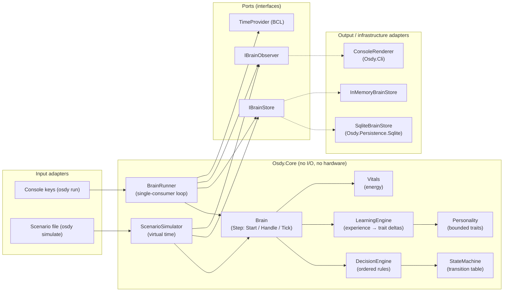

# Architecture

Osdy Brain is a **modular monolith with ports and adapters**: one process, one deterministic core, and thin adapters for storage, time, input and output. No microservices, no agent framework.

## Component diagram (v0.1)



Dependencies point inward: `Osdy.Cli` → `Osdy.Persistence.Sqlite` → `Osdy.Core`. `Osdy.Core` references only the .NET base library.

## Projects

| Project | Role | Depends on |
|---------|------|------------|
| `src/Osdy.Core` | Domain, decision rules, learning, loop, simulator, ports | BCL only |
| `src/Osdy.Persistence.Sqlite` | `IBrainStore` over SQLite | Core, Microsoft.Data.Sqlite |
| `src/Osdy.Cli` | Console host: `run`, `simulate`, `status`, `events export` | Core, Persistence.Sqlite |
| `tests/Osdy.Core.Tests` | Unit and simulation tests | Core |
| `tests/Osdy.Persistence.Sqlite.Tests` | Integration tests on real SQLite files | Core, Persistence.Sqlite |
| `tests/Osdy.Cli.Tests` | End-to-end CLI tests with fake time and I/O | Cli |

Folders inside `Osdy.Core` are named after the domain (screaming architecture): `Identity/`, `Personality/`, `States/`, `Vitals/`, `Events/`, `Decisions/`, `Experiences/`, `Runtime/`, `Simulation/`.

## Responsibilities (from the brief's subsystems)

| Brief subsystem | v0.1 component | v0.1 status |
|-----------------|----------------|-------------|
| A. Osdy Core | `Brain`, `BrainRunner`, `StateMachine`, `Vitals` | Implemented |
| B. Identity & Personality | `RobotIdentity`, `Personality`, `TraitEvolution` | 3 traits implemented |
| C. Emotional State Engine | — | Designed for v0.3 (energy is a vital, not an emotion) |
| D. Memory System | Episodic (events, experiences), behavioral log (decisions) | Partial; semantic/working memory in v0.2–v0.4 |
| E. Experience & Learning | `Experience`, `LearningEngine` | Implemented (rules + bounded updates) |
| F. Autonomous Behavior | Spontaneous rules (explore, timeouts, rest, wake) | Implemented with cooldowns |
| G. Decision Engine | `DecisionEngine` + `IDecisionRule` | Implemented |
| H. Perception & Expression | Events in, `BrainAction` out via observer | Simulated only |
| I. AI Integration | — | v0.4 (`ILanguageModel` port, optional) |

## Main interfaces

```csharp
// Persistence port: one transactional commit per brain step.
public interface IBrainStore
{
    BrainSnapshot? Load();
    void Commit(BrainSnapshot snapshot, StepResult step);
    IReadOnlyList<Decision> GetRecentDecisions(int count);
    IReadOnlyList<Experience> GetRecentExperiences(int count);
    IReadOnlyList<BrainEvent> GetEvents();
}

// Output port: everything the brain did in one step (decisions, actions, learning).
public interface IBrainObserver
{
    void OnStep(StepResult step);
    void OnError(Exception error);
}

// Decision rules: pure functions of the decision context.
public interface IDecisionRule
{
    string Name { get; }
    Decision? Evaluate(DecisionContext context);
}
```

The `Brain` itself exposes three synchronous operations — `Start(now)`, `Handle(event)` and `Tick(now)` — each returning a `StepResult`. Time is always passed in; the brain never reads a clock. This is what makes it deterministic and testable without waiting.

## Extension points we actually need

| Extension | How it plugs in | Phase |
|-----------|-----------------|-------|
| New perception source | Produce `BrainEvent`s into `BrainRunner.PostAsync` | v0.5 |
| New expression device | Implement `IBrainObserver`, map `BrainAction` to hardware | v0.5 |
| New storage | Implement `IBrainStore` | as needed |
| New behavior | Add an `IDecisionRule` to the ordered rule list | any |
| New learning rule | Add a `LearningRule` entry to `LearningOptions` | any |
| LLM provider | New `ILanguageModel` port, consulted only by deliberate rules | v0.4 |

Anything not on this list is deliberately not abstracted in v0.1.
