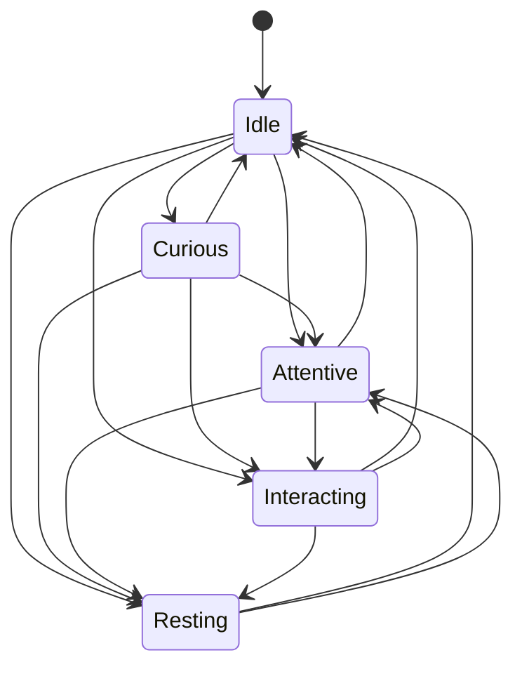

# Events and execution loop

## One step, three entry points

Every input goes through the same deterministic pipeline:

```
input (Start | Event | Tick at time t)
  1. advance vitals from LastUpdatedAt to t (energy drains or recovers by state)
  2. evaluate decision rules in priority order → first match wins (or explicit NoAction for events)
  3. validate and apply the state transition
  4. derive experience (if the event has one) → learning → trait changes
  5. return StepResult (nothing is persisted or printed by the Brain itself)
host: commit StepResult to IBrainStore (one transaction) → notify IBrainObserver
```

Persist **before** notify: the outside world never sees an action whose cause was not saved.

**Step time never goes backwards:** the brain uses `t = max(input time, LastUpdatedAt)`. An event posted just before a tick that was processed first is decided (and its experience and trait changes stamped) at the tick's time; the event itself keeps its observed `OccurredAt`. `osdy run` refuses a database whose last saved activity is later than the current time (left by `simulate --db`), because the live brain would stay frozen until the clock caught up.

## State machine



Forbidden on purpose: `Resting → Curious`, `Resting → Interacting` (waking up first passes through `Attentive`), `Attentive → Curious`.

## Decision rules (priority order)

| # | Rule | Trigger | Condition | Action → state | Kind |
|---|------|---------|-----------|----------------|------|
| 1 | `exhaustion` | Tick | `Energy < RestThreshold`, not Resting | `Rest` → Resting | Spontaneous |
| 2 | `wake-up` | Tick | Resting and `Energy ≥ WakeThreshold` | `WakeUp` → Idle | Spontaneous |
| 3 | `human-interaction` | `HumanInteractionDetected` | see below | `ObserveAndEngage` → Interacting / `ObserveCautiously` → Attentive / `WakeAndNotice` → Attentive / `NoAction` | Reactive |
| 4 | `human-presence` | `HumanPresenceDetected` | Idle or Curious | `NoticeHuman` → Attentive, else `NoAction` | Reactive |
| 5 | `interaction-feedback` | `PositiveInteraction` / `NegativeInteraction` | not Resting | `EnjoyInteraction` → Interacting / `BackOff` → Attentive | Reactive |
| 6 | `interaction-end` | `InteractionEnded`, `HumanLeft` | Interacting or Attentive | `ReturnToIdle` → Idle | Reactive |
| 7 | `novelty` | `NoveltyDetected` | Idle/Curious, `Curiosity ≥ NoveltyCuriosityThreshold`, enough energy | `Investigate` → Curious, else `NoAction` | Reactive |
| 8 | `timeouts` | Tick | Curious > `CuriousDuration`; Attentive/Interacting without interaction > timeout | `LoseInterest` / `ReturnToIdle` → Idle | Spontaneous |
| 9 | `spontaneous-explore` | Tick | Idle ≥ boredom time, `Energy ≥ ExploreMinEnergy`, cooldown elapsed | `ExploreSpontaneously` → Curious | Spontaneous |

**Engagement score** (rule 3): `engagement = 0.4·Sociability + 0.3·Curiosity + 0.3·Confidence` (weights configurable). If `Energy < MinEnergyToEngage` → `NoAction` ("too tired"). If Resting with enough energy → `WakeAndNotice`. Else `engagement ≥ EngageThreshold` → `ObserveAndEngage`, otherwise `ObserveCautiously`. This is where personality becomes visible behavior: a shy, unconfident instance observes from a distance; a sociable one engages.

**Boredom time** (rule 9): `IdleBeforeExplore × (1.5 − Curiosity)`. Curious instances get bored sooner.

If an event matches no rule, the brain records an explicit `NoAction` decision with the reason "No rule applies to E in state X". Ticks that change nothing are not recorded.

A deliberate action *re-enters* its target state even when the state does not change (e.g. `Investigate` while already Curious restarts the curiosity period). `NoAction` never resets the time in state.

## Vitals: energy

Energy changes linearly per hour according to the current state (defaults, configurable):

| State | Δ energy / hour |
|-------|-----------------|
| Idle | −0.02 |
| Curious | −0.10 |
| Attentive | −0.05 |
| Interacting | −0.15 |
| Resting | +0.30 |

Thresholds: `RestThreshold = 0.20`, `WakeThreshold = 0.80`, `MinEnergyToEngage = 0.30`, `ExploreMinEnergy = 0.50`.

## Runtime loop (`BrainRunner`)

```
producers                         single consumer
─────────                         ───────────────
PeriodicTimer(TickInterval) ─┐
console / adapters ──────────┼──▶ Channel<BrainInput> ──▶ brain.Step → store.Commit → observer.OnStep
                             ┘     (bounded, FIFO)
```

- One consumer means the `Brain` is never touched concurrently: no locks.
- The observer only receives steps that produced records (events, decisions, experiences, trait changes).
- On shutdown, events already posted are still processed, then a final checkpoint is saved.
- The timer uses the BCL `TimeProvider`, so tests drive it with a fake clock.
- **Failure handling:** if a step or commit throws, the runner reports it through `IBrainObserver.OnError`, reloads the brain from the last committed snapshot, and continues. After `MaxConsecutiveFailures` (default 5) it stops instead of looping on a broken store; `osdy run` then stops reading the keyboard and exits with code 1 and `[ERROR] Brain stopped after 5 consecutive failures.`

## Startup and restart recovery

1. `Load()` the snapshot; if none, create a new identity and initial traits.
2. Treat downtime as rest: energy recovers at the Resting rate for the elapsed time (capped at 1).
3. Transient states (`Curious`, `Attentive`, `Interacting`) are not resumed — whoever was there is probably gone. The brain records a `System` decision `RecoverAfterRestart` → Idle. `Idle` and `Resting` are resumed as-is.

## Rate limits and anti-annoyance

- `MinTimeBetweenSpontaneous` (default 5 min) — cooldown for spontaneous behavior.
- `TickInterval` (default 1 s) bounds the decision frequency of the loop.
- There is no reward for "getting attention": no rule increases its own frequency based on human response.
